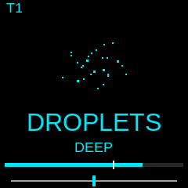

# bocjuhn — M-VAVE FM1 firmware

by **ryuji kanagawa** · Argentina · 2026

Six tracks for sound exploration, free loops and clocked performance. Eight
engines: FM, ACID, DROPLETS, FRACT, DRUID, RYUJI, HIVE and OBRADOR. Granular
processing, filters, modulation, effects, BALLSY, BRICKLAYER and PLAY ALONG.

Each engine has its own animated organism and saturated color on black.
Play, layer, loop and transform sounds through the FM1's physical controls
or try the complete instrument in your browser.



## Current prerelease: 1.0 RC10 — RYUJI VA + samples

RYUJI combines 10 integer VA percussion sources with 38 sampled/synthetic
one-shots, prioritizing 808/909. Recorded percussion and metallic sources,
clean zero-macro playback, longer tails, editable kits and random locks.
The original/accent bank remains compact; its LM/727 sounds are synthetic.
[Controls, sources, licensing and validation](docs/RC10.md).

The public and local simulators run RC10. Session format 32774 reads RC7–RC9;
existing RYUJI timbres intentionally change. Build with
`sh tests/ryuji_hybrid.sh` inside the host container. Package:
`release/bocjuhn-1.0-rc10/bocjuhn-1.0-rc10.fwsc`.
**RC10 hardware validation is pending.** [Download RC10](https://github.com/IanP06/bocjuhn/releases/tag/v1.0.0-rc10).

[Previous RC9 kits release](docs/RC9.md).

[Previous RC8 effects release](docs/RC8.md).

## Previous release: 1.0 RC7 — Living instruments

Engine-specific animated organisms, clean black screens, saturated engine
colors across tracks and menus, and redesigned temporary dials. Sound engines,
controls and RC5 session format are unchanged. [Release notes](docs/RC7.md).

**RC7 has been tested on the owner's physical M-VAVE FM1 and is confirmed working**
by ryuji kanagawa on 2026-11-02. Build, host, browser and package checks
are also recorded with the release. [Hardware test record](docs/HARDWARE-TEST.md).

[Play in your browser — no FM1 needed](https://ianp06.github.io/bocjuhn/)
· [Download RC7](https://github.com/IanP06/bocjuhn/releases/tag/v1.0.0-rc7)
· [Controls](ACID-CLOCK-RC5.txt)
· [Installation and recovery](release/bocjuhn-1.0-rc7/INSTALL-ES.txt)

## Simulator and installer

The public player runs at **https://ianp06.github.io/bocjuhn/**. Press Power to
enable sound, then play the keys or use your computer keyboard. Controls opens
the guide; PRESETS changes engine and the six upper buttons select tracks.
No MIDI or USB device is required. Nothing is flashed by the player.
The simulator's saved memory stays in your browser. Use Export memory to back it up.

Install Node.js, clone this repository and run:

```sh
node tools/serve_bocjuhn.cjs
```

Open http://127.0.0.1:8767 for the simulator and
http://127.0.0.1:8767/install for the installer. The simulator executes the
firmware C code compiled to WebAssembly. It does not model physical CPU timing.
Reading identity does not flash a device; installation requires the browser's
explicit install action. Use Chrome or Edge for Web MIDI installation.

Back up the physical FM1 before switching firmware. Simulator Export memory
backs up only the browser. RC7 reads RC5 sessions (32771); unrelated firmware
projects and samples are not guaranteed compatible and can be overwritten.
Earlier ANIMA sessions migrate to ACID as in RC5. See the installation guide.

## Build

Linux x86-64, Python 3 with Pillow, clang, Emscripten and Node.js are needed for
the complete software checks. The target uses the JieLi pi32v2 toolchain.
The supplied Dockerfile provides the host tools:

```sh
docker build -t bocjuhn-host -f tests/Dockerfile.host .
docker run --rm -v "$PWD:/work" bocjuhn-host sh tools/prepare_target.sh
docker run --rm -v "$PWD:/work" bocjuhn-host sh tests/fx_clock.sh
```

The test/build script expects the 20260730.1 toolchain under build/deps/jieli;
set JIELI_TOOLCHAIN in the script if using a different installation. The release
builder is tools/build_filter_release.py; output is build/rc9. Build metadata
hashes the firmware and generated headers. Product FM-1_197100, version B109.
The .fwsc includes the existing update loader; no separate data flash is needed.

## Firmware Hub

The existing [Firmware Hub card](https://thefirmwarehub.com/#bocjuhn) follows
GitHub releases and [fmhub.json](fmhub.json). The Hub documents synchronization
within three hours. [Update details](docs/HUB-SUBMISSION.txt).
RC7 operation was confirmed by the owner; RC8 hardware validation remains pending.

## License and credits

Firmware and new code: GPL-3.0-only. See [LICENSE](LICENSE),
[LICENSING.md](LICENSING.md), [LICENSES](LICENSES) and
[the original Tonitor README](README-TONITOR.md).
Based on [Tonitor](https://github.com/nzimas/tonitor) by Nuno Zimas,
which builds on Felucca and SLOOP. Their credits and licenses are retained.
Additional third-party components retain their licenses, including Plaits,
Rings, msfa and the bundled fonts. The new visual drawings are original,
inspired by JIANT's organisms and OP-1/OP-XY's instrument graphics.

This is unofficial community firmware, provided without warranty.

You can also try bocjuhn in the browser, no flashing needed, in the free community [FM-1 Emulator](https://fm1-emulator.atst.tools/).
